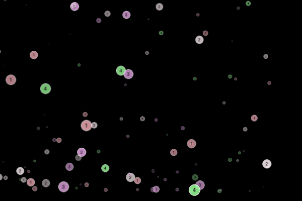
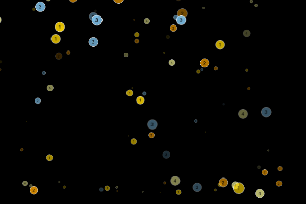
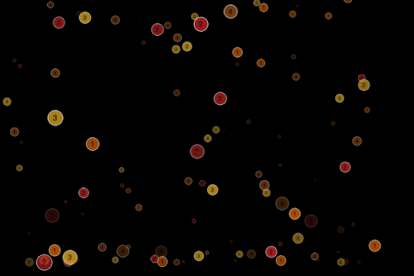

# Module: MMM-Seasons

A [MagicMirror²](https://magicmirror.builders/) module that lets things drift across your mirror, themed by the current season: blossoms in spring, sun motes in summer, leaves in fall and snow in winter. The theme switches automatically when the season changes.

Based on [MMM-Snow](https://github.com/MichMich/MMM-Snow) by Michael Teeuw.

> **Note:** The spring, summer and fall images are placeholders (numbered colored dots). Replace them with your own images (see [Using your own images](#using-your-own-images)).

| Spring | Summer |
|---|---|
|  |  |
| **Fall** | **Winter** |
|  |  |

## Installation

In your terminal, go to your MagicMirror's Module folder:
````
cd ~/MagicMirror/modules
````

Clone this repository:
````
git clone https://github.com/thomo/MMM-Seasons.git
````

Configure the module in your `config.js` file.

**Note:** After starting the Mirror, it will take a few seconds before the first flakes appear ...

## Using the module

To use this module, add it to the modules array in the `config/config.js` file:
````javascript
modules: [
	{
		module: 'MMM-Seasons',
		position: 'fullscreen_above',
		config: { // See 'Configuration options' for more information.
			flakeCount: 100,
			season: "auto"
		}
	}
]
````

## Configuration options

|Option|Description|
|---|---|
|`flakeCount`|The number of flakes. More flakes are heavier for the CPU, so don't go wild. <br>**Default value:** `100`|
|`season`|`auto` picks the theme from the current date. Set `spring`, `summer`, `fall` or `winter` to always show that theme.<br>**Default value:** `auto`|
|`seasonMode`|How the season is determined: `meteorological` (seasons start on 1 March, 1 June, 1 September, 1 December) or `astronomical` (seasons start at the equinoxes / solstices: about 20 March, 21 June, 22 September, 21 December).<br>**Default value:** `meteorological`|
|`hemisphere`|`north` or `south`. In the southern hemisphere the seasons are swapped.<br>**Default value:** `north`|
|`updateInterval`|How often (in ms) the module checks whether the season has changed.<br>**Default value:** `3600000` (one hour)|
|`seasons`|Per-season overrides of the theme settings, see below.<br>**Default value:** `{}`|

### Season settings

Each season (`spring`, `summer`, `fall`, `winter`) can be adjusted using the `seasons` option. Only the settings you specify are changed. All others keep their default values.

|Setting|Description|
|---|---|
|`imagesCount`|Number of images for this season.<br>**Default:** `4` (winter: `3`)|
|`imagePrefix`|Path and file name prefix of the images. The module loads `<imagePrefix>1<imageExtension>` … `<imagePrefix><imagesCount><imageExtension>`.<br>**Default:** `images/<season>/<season>`, e.g. `images/fall/fall`|
|`imageExtension`|File extension of the images.<br>**Default:** `.png`|
|`images`|An explicit list of image files. If set, it is used instead of `imagePrefix`, `imagesCount` and `imageExtension`.<br>**Default:** `null`|
|`downwards`|`true` makes the flakes fall down, `false` makes them rise up.<br>**Default:** `true` (summer: `false`)|
|`sizeFactor`|Scales the flakes. Values below 1 make them smaller, values above 1 make them larger.<br>**Default:** `1.5` (winter: `1`)|

Relative image paths are resolved against the module folder (`~/MagicMirror/modules/MMM-Seasons/`). Paths starting with `/` and URLs (`http://…`) are used as they are.

## Using your own images

Images should be PNGs with a transparent background and about 50x50 pixels in size.

The easiest way is to replace the placeholder files in `images/spring`, `images/summer` and `images/fall` with your own files under the same names. To use a different number of images, set `imagesCount`:

````javascript
config: {
	seasons: {
		spring: { imagesCount: 6 }  // uses images/spring/spring1.png ... spring6.png
	}
}
````

You can also keep your images in a separate folder, so they are not touched by a `git pull`:

````javascript
config: {
	seasons: {
		spring: { imagePrefix: "my-images/blossom", imagesCount: 5 },          // my-images/blossom1.png ... blossom5.png
		fall:   { images: [ "my-images/oak.png", "my-images/maple.png" ], sizeFactor: 2 },
		summer: { downwards: true }
	}
}
````

To hide the module in one season, set `imagesCount: 0` for that season.
