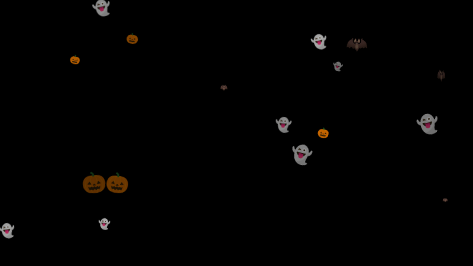
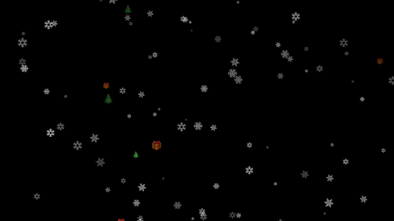

# Module: MMM-Seasons

A [MagicMirror²](https://magicmirror.builders/) module that lets things drift across your mirror, themed by the current season: flowers moving around in spring, butterflies and fireflies in summer, leaves blown by the wind in fall and snow in winter. The theme switches automatically when the season changes, and special occasions like Halloween, Christmas or New Year's Eve take over on their dates.

Based on [MMM-Snow](https://github.com/MichMich/MMM-Snow) by Michael Teeuw.

| Spring | Summer |
|---|---|
|  |  |
| **Fall** | **Winter** |
|  |  |
| **Halloween** | **Christmas** |
|  |  |

## Installation

In your terminal, go to your MagicMirror's Module folder:
````
cd ~/MagicMirror/modules
````

Clone this repository:
````
git clone https://github.com/thomo/MMM-Seasons.git
````

Most themes use emoji. On a Raspberry Pi you may need to install an emoji font first:
````
sudo apt install fonts-noto-color-emoji
````

Configure the module in your `config.js` file.

## Using the module

To use this module, add it to the modules array in the `config/config.js` file:
````javascript
modules: [
	{
		module: 'MMM-Seasons',
		position: 'fullscreen_above',
		config: { // See 'Configuration options' for more information.
			theme: "auto"
		}
	}
]
````

## Configuration options

|Option|Description|
|---|---|
|`theme`|`auto` picks the theme from the current date. Set a season (`spring`, `summer`, `fall`, `winter`) or an occasion (e.g. `halloween`) to always show that theme.<br>**Default value:** `auto`|
|`seasonMode`|How the season is determined: `meteorological` (seasons start on 1 March, 1 June, 1 September, 1 December) or `astronomical` (seasons start at the equinoxes / solstices: about 20 March, 21 June, 22 September, 21 December).<br>**Default value:** `meteorological`|
|`hemisphere`|`north` or `south`. In the southern hemisphere the seasons are swapped.<br>**Default value:** `north`|
|`density`|Multiplies the number of flakes of every theme. More flakes are heavier for the CPU and make the mirror harder to read.<br>**Default value:** `1`|
|`opacity`|Maximum opacity of the flakes (0 to 1). Every flake gets a random opacity below this value.<br>**Default value:** `0.8`|
|`updateInterval`|How often (in ms) the module checks whether the season or occasion has changed.<br>**Default value:** `3600000` (one hour)|
|`seasons`|Changes the settings of a season theme, see [Theme settings](#theme-settings).<br>**Default value:** `{}`|
|`occasions`|Changes, disables or adds special occasions, see [Special occasions](#special-occasions).<br>**Default value:** `{}`|

## Themes

|Theme|Flakes|Movement|Flakes on the mirror|
|---|---|---|---|
|`spring`|🌸 🌼|`around`|30|
|`summer`|🦋 (`long around`) and ✨ fireflies (`upwards`)|`long around`|25|
|`fall`|🍂 🍁 🍃 and an occasional 🌰|`windy`|40|
|`winter`|snowflake images (`images/winter`)|`downwards`|100|

### Movements

|Movement|Description|
|---|---|
|`downwards`|Falls down and sways sideways, like snow.|
|`upwards`|Rises up and twinkles, like fireflies or bubbles.|
|`windy`|Is blown diagonally across the mirror in gusts and tumbles, like leaves in the wind.|
|`around`|Moves around a spot and fades in and out, then shows up somewhere else, like flowers in spring.|
|`long around`|Flies across the whole mirror along a wavy line and flutters, like butterflies.|

### Theme settings

Each season can be changed using the `seasons` option. Only the settings you specify are changed; all others keep their default values.

|Setting|Description|
|---|---|
|`movement`|One of the movements above.|
|`flakeCount`|Number of flakes. Set it to `0` to hide the module in that season.|
|`size`|Maximum flake size in pixels. Every flake gets a random size up to this value.|
|`speed`|Speed factor, `2` is twice as fast, `0.5` half as fast.<br>**Default:** `1`|
|`sway`|How far the flakes sway sideways, `0` is no sway.<br>**Default:** `1`|
|`opacity`|Opacity factor of this theme, multiplied with the global `opacity`.<br>**Default:** `1`|
|`emojis`|List of emojis to show. Only used when the theme has no images.|
|`images`|List of image files to show instead of the emojis.|
|`imagePrefix`, `imagesCount`, `imageExtension`|Another way to define images: the module loads `<imagePrefix>1<imageExtension>` … `<imagePrefix><imagesCount><imageExtension>`. The default prefix is `images/<season>/<season>`, the default extension `.png`.|

An entry of `emojis` or `images` can be a plain value (`"🍂"`, `"my-images/oak.png"`) or an object with its own settings:

|Field|Description|
|---|---|
|`emoji` / `image`|The emoji or the image file.|
|`weight`|How often this entry is picked compared to the others.<br>**Default:** `1`. For example, `0.1` makes it rare.|
|`movement`, `size`, `speed`, `sway`, `opacity`|Overrides the theme setting for this entry only.|

````javascript
config: {
	seasons: {
		spring: {
			emojis: ["🌸", "🌼", { emoji: "🐝", weight: 0.2, movement: "long around", size: 20 }]
		},
		winter: {
			movement: "downwards",
			speed: 0.7,
			images: ["images/winter/winter1.png", "images/winter/winter2.png", { image: "images/winter/winter3.png", weight: 2 }]
		}
	}
}
````

More ideas: 🌧️ light rain in spring, dandelion seeds, 🫧 bubbles or ☀️ sun sparkles in summer, 🍄 mushrooms in fall, ⛄ or ice sparkles in winter.

## Using your own images

Emoji are easy to use but look different on each operating system and browser. Images look the same everywhere. Use PNGs (or SVGs) with a transparent background, about 50x50 pixels.

The folders `images/spring`, `images/summer` and `images/fall` contain 4 placeholder images each (numbered colored dots). Replace them with your own files under the same names, and enable them with `imagesCount`:

````javascript
config: {
	seasons: {
		spring: { imagesCount: 4 },  // uses images/spring/spring1.png ... spring4.png instead of the emojis
		summer: { imagesCount: 6 }   // uses images/summer/summer1.png ... summer6.png
	}
}
````

You can also keep your images in a separate folder, so they are not touched by a `git pull` (`my-images/` is ignored by git):

````javascript
config: {
	seasons: {
		spring: { imagePrefix: "my-images/blossom", imagesCount: 5 },     // my-images/blossom1.png ... blossom5.png
		fall:   { images: ["my-images/oak.png", "my-images/maple.png"], size: 40 }
	}
}
````

Relative image paths are resolved against the module folder (`~/MagicMirror/modules/MMM-Seasons/`). Paths starting with `/` and URLs (`http://…`) are used as they are.

## Special occasions

Occasions are themes that are shown between two dates (`from` and `to`, as `"MM-DD"`, both days included) and replace the season theme. If several occasions are active, the one with the shortest date range wins, so a birthday on 12 December beats Christmas.

|Occasion|Dates|Flakes|
|---|---|---|
|`halloween`|24 Oct – 31 Oct|🎃 👻 moving `around`, 🦇 flying `long around`|
|`christmas`|1 Dec – 26 Dec|🎄 🎁 mixed into the season's flakes (`mixWithSeason`)|
|`newYear`|31 Dec – 1 Jan|🎆 🎇 ✨ rising `upwards`|

An occasion takes the same settings as a season theme, plus:

|Setting|Description|
|---|---|
|`from`, `to`|First and last day, as `"MM-DD"`. The range may span the end of the year (`"12-31"` to `"01-01"`).|
|`mixWithSeason`|`true` adds the occasion's flakes to the flakes of the current season, instead of replacing them.<br>**Default:** `false`|

Settings an occasion does not define (e.g. `movement` or `flakeCount`) are taken from the current season.

````javascript
config: {
	occasions: {
		halloween: false,                                   // disable an occasion
		christmas: { mixWithSeason: false, emojis: ["🎄", "🎁", "⭐"], movement: "around" },
		birthday:  { from: "05-12", to: "05-12", emojis: ["🎂", "🎈", "🎉"], movement: "upwards" }
	}
}
````
